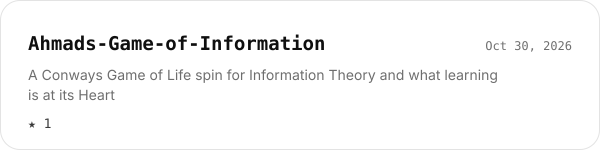
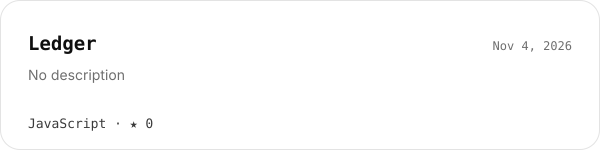
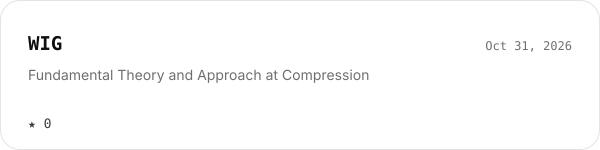

<picture><source media="(prefers-color-scheme: dark)" srcset="docs/readme/header-dark.svg"></picture>

## `01` · On GitHub

<table>
<tr>
<td width="50%" valign="top"><a href="https://github.com/Ahmadhussain0033/Ahmads-Game-of-Information"><picture><source media="(prefers-color-scheme: dark)" srcset="docs/readme/repo-0-dark.svg"></picture></a></td>
<td width="50%" valign="top"><a href="https://github.com/Ahmadhussain0033/Turing-Machines"><picture><source media="(prefers-color-scheme: dark)" srcset="docs/readme/repo-1-dark.svg"></picture></a></td>
</tr>
<tr>
<td width="50%" valign="top"><a href="https://github.com/Ahmadhussain0033/run-xero-identity"><picture><source media="(prefers-color-scheme: dark)" srcset="docs/readme/repo-2-dark.svg"></picture></a></td>
<td width="50%" valign="top"><a href="https://github.com/Ahmadhussain0033/Ledger"><picture><source media="(prefers-color-scheme: dark)" srcset="docs/readme/repo-3-dark.svg"></picture></a></td>
</tr>
<tr>
<td width="50%" valign="top"><a href="https://github.com/Ahmadhussain0033/WIG"><picture><source media="(prefers-color-scheme: dark)" srcset="docs/readme/repo-4-dark.svg"></picture></a></td>
<td></td>
</tr>
</table>

## `02` · Get in touch

---

This page rebuilds itself from 1 live source · <a href="https://ahmadhussain0033.github.io/Ledger/">open the interactive version</a> · <a href="docs/SETUP.md">how it works</a>

