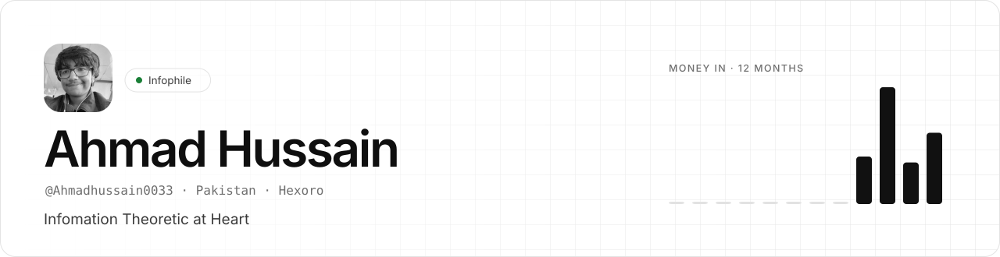
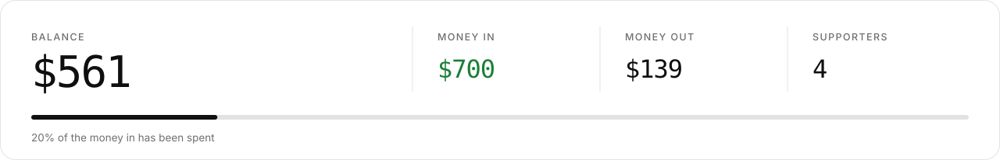
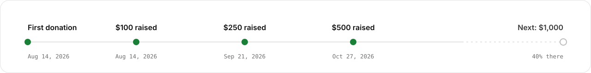

<picture><source media="(prefers-color-scheme: dark)" srcset="docs/readme/header-dark.svg"></picture>

> **My open ledger.** What I'm building, what it costs, who's chipped in, and where every dollar goes. Every number here is pulled from the source and refreshed automatically.

<picture><source media="(prefers-color-scheme: dark)" srcset="docs/readme/money-dark.svg"></picture>

## `01` · The ledger

Latest money in and out. Search the full history and every receipt on the <a href="https://ahmadhussain0033.github.io/Ledger/#search">live ledger</a>.

| Date | | Entry | Amount | Receipt |
|---|:-:|---|--:|:-:|
| Nov 2, 2026 | in | **Ahmad** Workstation fund · Direct | +$180 |  |
| Oct 30, 2026 | out | **USB microphone** Amazon · hardware | −$89 | personal |
| Oct 27, 2026 | in | **Anonymous** Direct | +$30 |  |
| Oct 12, 2026 | out | **VPS, 3 months** Hetzner · infra | −$36 | personal |
| Oct 9, 2026 | in | **Anon** Keep going · Direct | +$75 |  |
| Sep 25, 2026 | out | **Domain renewal** Namecheap · infra | −$14 | personal |
| Sep 21, 2026 | in | **Ahmad** Hosting for the year · Direct | +$250 |  |
| Sep 3, 2026 | in | **Anonymous** Good luck with it · Direct | +$45 |  |
| Aug 14, 2026 | in | **Ahmad** Getting things started · Direct | +$120 |  |

Spent by category: <code>hardware</code> $89 · <code>infra</code> $50

## `02` · Milestones

<picture><source media="(prefers-color-scheme: dark)" srcset="docs/readme/milestones-dark.svg"></picture>

## `03` · Supporters

Thank you. Anonymous gifts count toward the totals but are never named.

| | Name | Total | Gifts |
|--:|---|--:|--:|
| 1 | **Ahmad** | $550 | 3 |
| 2 | **Anon** | $75 | 1 |

Plus 2 anonymous gifts totalling $75.

## `04` · Get in touch

---

<b>Hexoro 2026</b>

