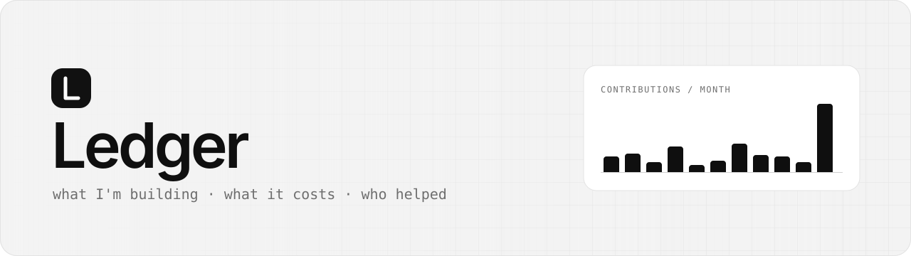
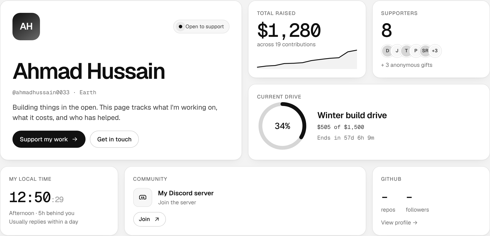
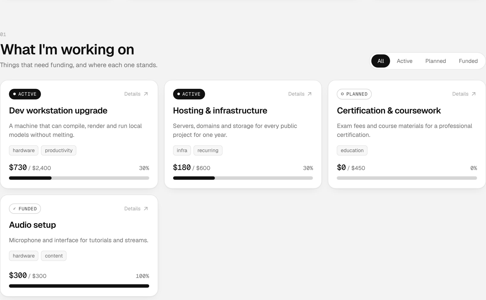
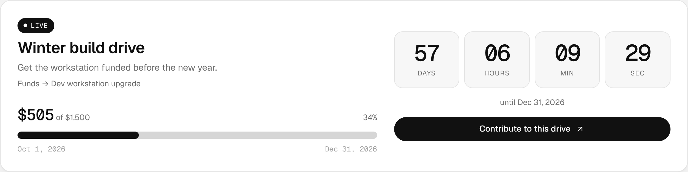
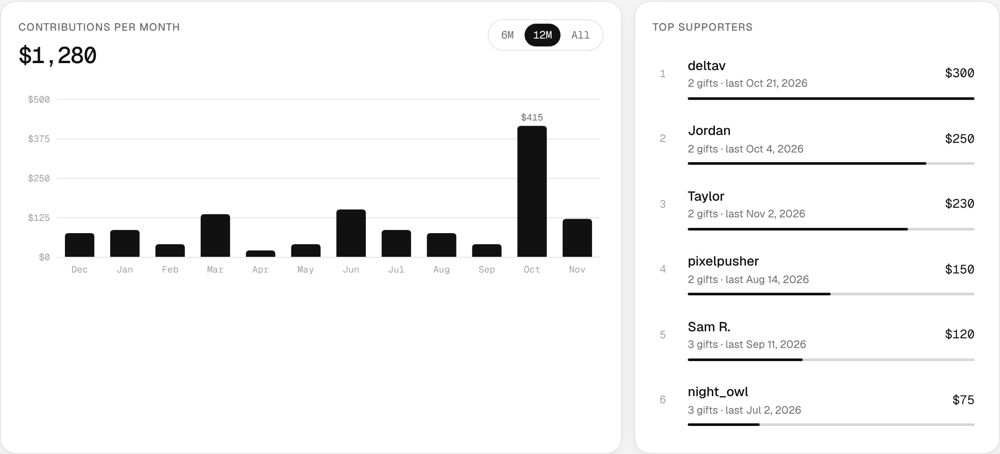
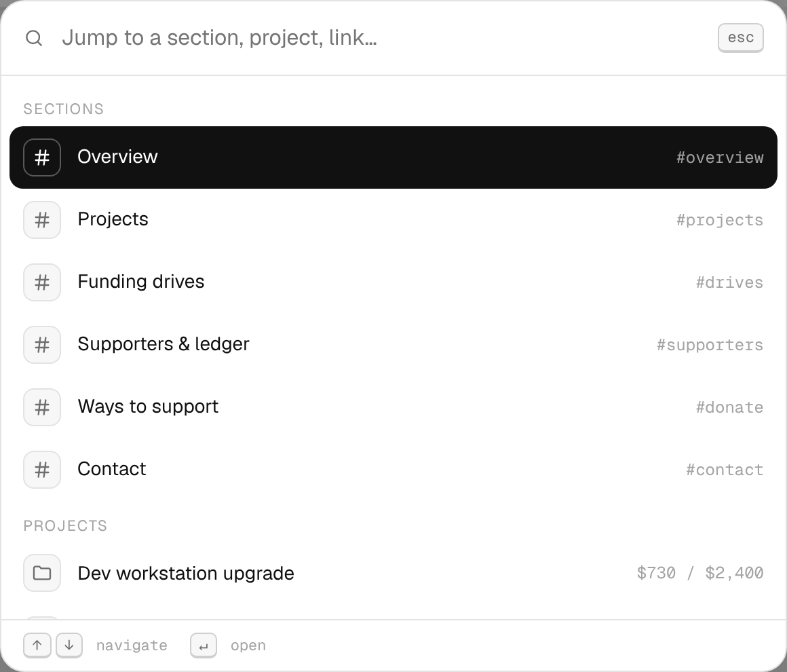
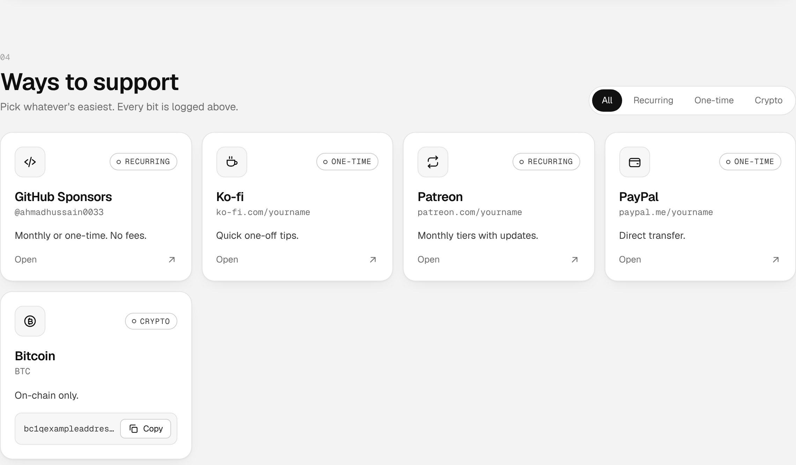
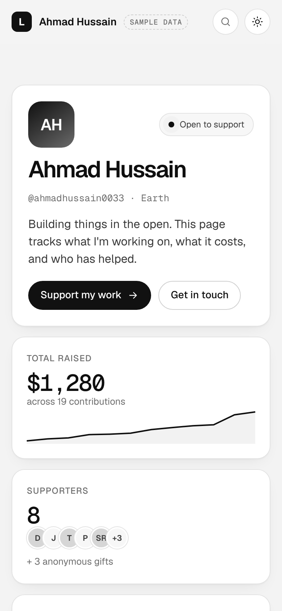

<div align="center">

<picture>
  <source media="(prefers-color-scheme: dark)" srcset="docs/banner-dark.svg">
  
</picture>

<br>

**A public, open ledger of what I'm building, what it costs, and who helped make it happen.**

<br>

[](https://ahmadhussain0033.github.io/Ledger/)


[Overview](#01--overview) · [Features](#02--features) · [Make it yours](#03--make-it-yours) · [Live widgets](#04--live-widgets) · [Run & deploy](#05--run--deploy) · [Structure](#06--structure)

</div>

<br>

<picture>
  <source media="(prefers-color-scheme: dark)" srcset="docs/overview-dark.png">
  
</picture>

<br><br>

## `01` · Overview

Ledger is a single page that tracks:

| | |
|---|---|
| **Projects** | what I'm working on that needs money, and how close each one is |
| **Funding drives** | time-boxed goals with a live countdown |
| **Supporters** | every contribution, logged, searchable, with a monthly chart and leaderboard |
| **Ways to support** | donation platforms, recurring or one-time, plus crypto with copy-to-clipboard |
| **Contact** | email, Discord server, and socials |

Everything is grayscale, minimal, and works in light and dark mode. It is driven by **one data file**.

<br>

## `02` · Features

<table>
<tr>
<td width="50%" valign="top">

**Projects with progress**<br>
<sub>Filter by status. Click a card for details, backers and what's still needed.</sub>

<picture>
  <source media="(prefers-color-scheme: dark)" srcset="docs/projects-dark.png">
  
</picture>

</td>
<td width="50%" valign="top">

**Funding drives**<br>
<sub>Live days / hours / minutes / seconds countdown and goal tracking.</sub>

<picture>
  <source media="(prefers-color-scheme: dark)" srcset="docs/drive-dark.png">
  
</picture>

</td>
</tr>
<tr>
<td width="50%" valign="top">

**Supporters chart & leaderboard**<br>
<sub>Monthly totals (6M / 12M / All) with hover and keyboard tooltips.</sub>

<picture>
  <source media="(prefers-color-scheme: dark)" srcset="docs/chart-dark.png">
  
</picture>

</td>
<td width="50%" valign="top">

**Command palette**<br>
<sub>Press <kbd>⌘</kbd> <kbd>K</kbd>, <kbd>Ctrl</kbd> <kbd>K</kbd> or <kbd>/</kbd> to jump anywhere.</sub>

<picture>
  <source media="(prefers-color-scheme: dark)" srcset="docs/palette-dark.png">
  
</picture>

</td>
</tr>
<tr>
<td width="50%" valign="top">

**Ways to support**<br>
<sub>Filter by recurring, one-time or crypto. Wallet addresses copy in one click.</sub>

<picture>
  <source media="(prefers-color-scheme: dark)" srcset="docs/donate-dark.png">
  
</picture>

</td>
<td width="50%" valign="top" align="center">

**Built for phones too**<br>
<sub>Responsive to 360px. Respects reduced-motion.</sub>

<picture>
  <source media="(prefers-color-scheme: dark)" srcset="docs/mobile-dark.png">
  
</picture>

</td>
</tr>
</table>

<sub>Screenshots show sample data.</sub>

**Also:** searchable, sortable ledger table · animated counters and progress · pointer spotlight on cards · scroll-spy nav · remembered light/dark toggle · zero tracking.

<br>

## `03` · Make it yours

> [!TIP]
> **You only edit one file: [`data.js`](data.js).** Replace the sample values, then set `demo: false` to remove the *sample data* badge.

| Section on the site | Key in `data.js` | What goes in it |
|---|---|---|
| Header & profile | `profile` | name, handle, tagline, timezone, avatar URL, status |
| What I'm working on | `projects` | title, goal, `status` (`active` · `planned` · `funded` · `paused`), tags |
| Funding drives | `drives` | goal, `start` / `end` dates, optional linked `project` |
| People who've helped | `contributions` | one row per payment: name, amount, date, project, platform, note, `anonymous` |
| Ways to support | `platforms` | link, `kind` (`recurring` · `one-time` · `crypto`), crypto `address` |
| Get in touch | `contacts` | email, Discord, GitHub username, socials |

**Logging a payment** is one line:

```js
{ name: "Jordan", amount: 50, date: "2026-11-04", project: "workstation", platform: "PayPal", note: "good luck!" },
```

### How the numbers work

```text
contributions ──┬──► project progress     (matched by project id)
                ├──► drive progress       (dated inside start…end)
                ├──► total raised · supporters · leaderboard
                └──► monthly chart
```

The contribution list is the **single source of truth**. Log a payment once and every widget updates, so the totals always agree. Money you'd rather not itemise can go in a project's `raisedExternal`.

<br>

## `04` · Live widgets

| Widget | Setup | Notes |
|---|---|---|
| **Discord online count** | Put your server ID in `contacts.discord.serverId`, then in Discord: *Server Settings → Widget → Enable Server Widget* | Without it, the card shows a join button only |
| **GitHub stats** | Set `contacts.github` to your username | Public API, no key. Rate-limited per visitor; shows `–` if limited |
| **Local time** | Set `profile.timezone` (e.g. `America/New_York`) | Shows how far ahead or behind the visitor you are |

<br>

## `05` · Run & deploy

**Locally:** open `index.html`, or serve the folder:

```bash
python3 -m http.server 8000
```

**GitHub Pages:** *Settings → Pages → Build and deployment → Deploy from a branch → `main` / `(root)`*. The site goes live at **[ahmadhussain0033.github.io/Ledger](https://ahmadhussain0033.github.io/Ledger/)**.

<br>

## `06` · Structure

```text
Ledger/
├── index.html    page layout
├── styles.css    grayscale design tokens, light + dark
├── app.js        rendering, widgets, chart, palette
├── data.js       ← your info lives here
└── docs/         README images
```

<br>

<div align="center">
<sub>Built in the open · <a href="#">back to top ↑</a></sub>
</div>
